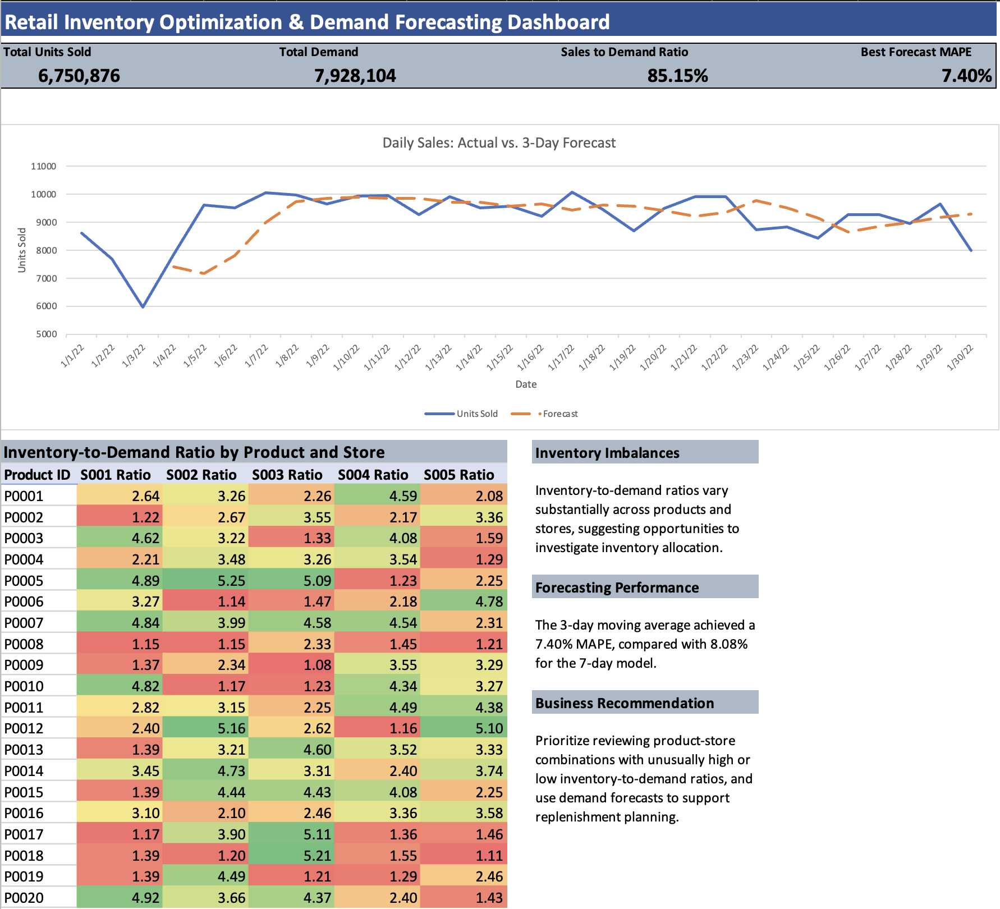

# Retail Inventory Optimization & Demand Forecasting

## Project Overview

This project analyzes **76,000 simulated retail inventory records across 5 stores and 20 products** to examine inventory distribution, sales performance, and forecasting accuracy.

Using **Microsoft Excel, Power BI, and SQL**, I analyzed retail sales and inventory patterns, developed short-term sales forecasts, and created dashboards to communicate findings relevant to inventory planning.

In Excel, I developed 3-day and 7-day moving-average forecasts using historical daily sales and evaluated their accuracy using MAD and MAPE. In Power BI, I created an interactive dashboard to visualize sales, demand, and inventory patterns. Using SQL, I queried the dataset to analyze store performance, rank products by sales, and compare inventory-to-demand ratios across product-store combinations.

## Dashboard Previews

### Power BI Dashboard

*Power BI dashboard featuring sales and demand KPIs, interactive store and product filters, daily sales trends, and inventory-to-demand analysis.*

### Excel Dashboard

*Excel dashboard featuring sales forecasting, inventory comparisons, and operational performance metrics.*

## Tools & Skills

- **Microsoft Excel:** PivotTables, formulas, moving-average forecasting, and dashboard development
- **Microsoft Power BI:** Power Query, DAX measures, interactive slicers, and data visualization
- **SQL (SQLite):** Data aggregation, JOINs, Common Table Expressions (CTEs), and window functions
- **Inventory Analysis:** Inventory-to-demand ratios and product-store comparisons
- **Forecast Evaluation:** Mean Absolute Deviation (MAD) and Mean Absolute Percentage Error (MAPE)
- **Business Analytics:** KPI reporting, data interpretation, and operational recommendations

## Key Performance Indicators

| Metric | Result |
|---|---:|
| Total Units Sold | 6,750,876 |
| Total Demand | 7,928,104 |
| Sales-to-Demand Ratio | 85.15% |
| 3-Day Moving Average MAPE | 7.40% |
| 7-Day Moving Average MAPE | 8.08% |

*Forecast accuracy metrics were calculated in Excel. The 3-day forecast MAPE is displayed in Power BI as an overall summary and does not change with store or product slicers.*

## Analysis & Key Findings

### 1. Inventory Analysis

- Analyzed inventory and demand patterns across 20 products and 5 stores.
- Developed an inventory-to-demand heatmap to compare 100 product-store combinations.
- Identified variations in inventory-to-demand ratios that could warrant further investigation into inventory allocation and replenishment.

### 2. Sales Forecasting

- Developed 3-day and 7-day moving-average forecasts using historical daily sales.
- Evaluated forecast accuracy using MAD and MAPE.
- The 3-day moving average produced a reported MAPE of **7.40%**, compared with **8.08%** for the 7-day moving average.
- Visualized actual sales against forecasted sales to examine short-term patterns.

**Forecasting limitation:** The two models were evaluated over slightly different date ranges, so their reported accuracy metrics should not be treated as a controlled comparison.

### 3. SQL Analysis

Used SQLite to query the retail inventory dataset and analyze sales, demand, and inventory performance.

- **Dataset Verification:** Used `COUNT()` and `COUNT(DISTINCT)` to verify record counts and the number of stores and products.
- **Store Performance:** Used `SUM()` and `GROUP BY` to calculate total sales, total demand, and sales-to-demand percentages by store.
- **Product Rankings:** Applied the `RANK()` window function to rank products by total units sold.
- **Inventory Analysis:** Used a Common Table Expression (CTE) to calculate average inventory, average demand, and inventory-to-demand ratios for product-store combinations.
- **Product-Level Comparisons:** Used CTEs and an `INNER JOIN` to compare aggregated sales and demand by product.

The SQL queries complement the Excel and Power BI analysis by demonstrating how retail performance metrics can be calculated and compared using SQL.

### 4. Excel Dashboard Development

Developed an Excel dashboard featuring:

- Four key performance indicators (KPIs)
- Actual sales versus 3-day moving-average forecasts
- Product-store inventory-to-demand heatmap
- Business insights and recommendations

### 5. Power BI Dashboard Development

Developed an interactive Power BI dashboard featuring:

- **Four KPI Cards:** Total Units Sold, Total Demand, Sales-to-Demand Ratio, and 3-Day Forecast MAPE
- **Daily Sales Volume:** Line chart showing sales trends over time
- **Sales vs. Demand by Store:** Clustered column chart comparing sales and demand across five stores
- **Inventory-to-Demand Heatmap:** Matrix visual with conditional formatting across products and stores
- **Interactive Filtering:** Store ID and Product ID slicers for exploring operational performance

Used Power Query to prepare the data and DAX measures to calculate and display business metrics.

## Business Recommendations

1. **Investigate Inventory Imbalances:** Review product-store combinations with unusually high or low inventory-to-demand ratios to identify potential allocation issues.
2. **Improve Replenishment Planning:** Consider incorporating short-term forecasts into inventory planning to support more informed ordering decisions.
3. **Monitor Forecast Accuracy:** Track forecasting errors over time and evaluate alternative forecasting methods as sales patterns change.
4. **Improve Operational Visibility:** Use interactive dashboards to monitor sales, demand, and inventory patterns across stores and products.

## Project Files

| File | Description |
|---|---|
| `Retail_Inventory_Analysis.xlsx` | Excel workbook containing inventory analysis, forecasting calculations, accuracy evaluation, and dashboard |
| `Retail_Inventory_Dashboard.pbix` | Power BI report with DAX measures, interactive slicers, and visualizations |
| `Retail_Inventory_Analysis.sql` | SQL queries for dataset verification, store performance, product rankings, inventory ratios, and product-level comparisons |
| `Excel_Dashboard.png` | Screenshot of the completed Excel dashboard |
| `Power_BI_Dashboard.png` | Screenshot of the completed Power BI dashboard |
| `README.md` | Project documentation, methodology, and findings |

## Dataset

This project uses a synthetic retail inventory dataset obtained from Kaggle, containing **76,000 records across 5 stores and 20 products**.

**Disclaimer:** All results are based on simulated data and demonstrate analytical methods rather than actual business performance. Inventory-to-demand ratios are descriptive indicators and do not independently establish overstocking or stockouts. Similarly, differences between recorded demand and sales do not necessarily represent lost sales.

## Project Takeaways

This project strengthened my skills in Excel, Power BI, SQL, sales forecasting, and inventory analysis. It provided experience using multiple analytical tools to examine operational data, develop visualizations, and communicate findings relevant to business analytics and supply chain management.
