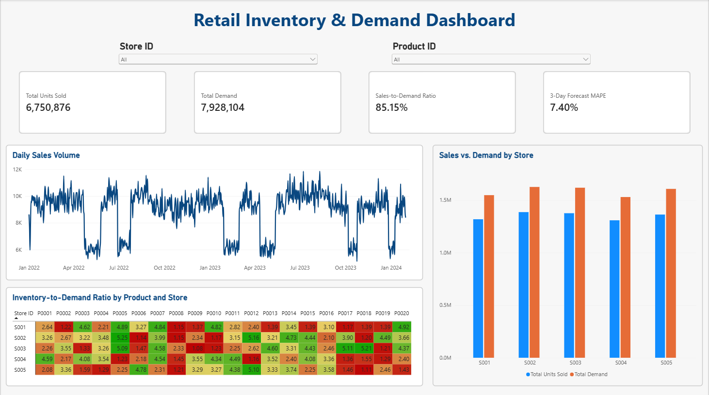

# Retail Inventory Optimization & Demand Forecasting

## Project Overview

This project analyzes **76,000 simulated retail inventory records across 5 stores and 20 products** to evaluate inventory distribution, sales performance, and forecasting accuracy.

Using **Microsoft Excel and Power BI**, I developed forecasting models, analyzed inventory-to-demand patterns, and created dashboards to communicate findings and support inventory planning decisions.

In Excel, I built 3-day and 7-day moving-average forecasts, evaluated their accuracy using MAD and MAPE, and developed an inventory analysis dashboard. In Power BI, I created an interactive dashboard featuring sales and demand KPIs, daily sales trends, store-level comparisons, and a product-store inventory heatmap.

## Dashboard Previews

### Power BI Dashboard

*Interactive dashboard featuring sales and demand KPIs, Store ID and Product ID slicers, daily sales trends, and inventory-to-demand analysis.*

### Excel Dashboard

*Excel dashboard featuring demand forecasting, inventory comparisons, and operational performance metrics.*

## Tools & Skills

- **Microsoft Excel:** PivotTables, formulas, data analysis, and dashboard development
- **Microsoft Power BI:** Power Query, DAX measures, interactive slicers, and dashboard development
- **Inventory Analysis:** Inventory-to-demand ratios and product-store comparisons
- **Demand Forecasting:** 3-day and 7-day moving averages
- **Forecast Evaluation:** Mean Absolute Deviation (MAD) and Mean Absolute Percentage Error (MAPE)
- **Data Visualization:** Line charts, clustered column charts, conditional formatting, heatmaps, and KPI dashboards
- **Business Analytics:** Data interpretation and operational recommendations

## Key Performance Indicators

| Metric | Result |
|---|---:|
| Total Units Sold | 6,750,876 |
| Total Demand | 7,928,104 |
| Sales-to-Demand Ratio | 85.15% |
| 3-Day Moving Average MAPE | 7.40% |
| 7-Day Moving Average MAPE | 8.08% |

*The forecasting accuracy metrics were calculated in Excel. The 3-day forecast MAPE is displayed in Power BI as an overall summary and does not change with store or product slicers.*

## Analysis & Key Findings

### 1. Inventory Analysis

- Analyzed inventory and demand patterns across 20 products and 5 stores.
- Developed an inventory-to-demand heatmap using conditional formatting to compare 100 product-store combinations.
- Identified variations in inventory-to-demand ratios, highlighting opportunities to investigate inventory allocation and replenishment strategies.

### 2. Demand Forecasting

- Developed 3-day and 7-day moving-average forecasting models using historical daily sales.
- Evaluated forecasting accuracy using MAD and MAPE.
- The 3-day moving average achieved a reported MAPE of **7.40%**, compared with **8.08%** for the 7-day moving average.
- Visualized actual sales against forecasted sales to evaluate short-term patterns.

**Forecasting limitation:** The two models were initially evaluated over slightly different date ranges, so their reported accuracy metrics are descriptive rather than a fully controlled comparison.

### 3. Excel Dashboard Development

Developed an Excel dashboard featuring:

- Four key performance indicators (KPIs)
- Actual sales versus 3-day moving-average forecasts
- Product-store inventory-to-demand heatmap
- Business insights and recommendations

### 4. Power BI Dashboard Development

Developed an interactive Power BI dashboard featuring:

- **Four KPI cards:** Total Units Sold, Total Demand, Sales-to-Demand Ratio, and 3-Day Forecast MAPE
- **Daily Sales Volume:** Line chart visualizing sales trends over time
- **Sales vs. Demand by Store:** Clustered column chart comparing sales and demand across five stores
- **Inventory-to-Demand Heatmap:** Matrix visual with conditional formatting across products and stores
- **Interactive Filtering:** Store ID and Product ID slicers for exploring operational performance

Used Power Query to prepare the data and DAX measures to calculate and display business metrics.

## Business Recommendations

1. **Investigate Inventory Imbalances:** Review product-store combinations with unusually high or low inventory-to-demand ratios to identify potential allocation issues.
2. **Improve Replenishment Planning:** Incorporate short-term forecasts into inventory planning to support more informed ordering decisions.
3. **Monitor Forecast Accuracy:** Track forecasting errors over time and evaluate alternative forecasting methods as sales patterns change.
4. **Improve Operational Visibility:** Use interactive dashboards to monitor sales, demand, and inventory patterns across stores and products.

## Project Files

| File | Description |
|---|---|
| `Retail_Inventory_Analysis.xlsx` | Excel workbook containing inventory analysis, forecasting calculations, accuracy evaluation, and dashboard |
| `Retail_Inventory_Dashboard.pbix` | Interactive Power BI report with DAX measures, slicers, and visualizations |
| `Excel_Dashboard.png` | Screenshot of the completed Excel dashboard |
| `Power_BI_Dashboard.png` | Screenshot of the completed Power BI dashboard |
| `README.md` | Project documentation, methodology, and findings |

## Dataset

This project uses a synthetic retail inventory dataset obtained from Kaggle, containing **76,000 records** across 5 stores and 20 products.

**Disclaimer:** All results are based on simulated data and are intended to demonstrate analytical methods rather than actual business performance. Inventory-to-demand ratios are descriptive indicators and do not independently establish overstocking or stockouts. Similarly, differences between recorded demand and sales do not necessarily represent lost sales.

## Project Takeaways

This project strengthened my skills in Excel, Power BI, demand forecasting, and inventory analysis. It also gave me experience turning data into visualizations and actionable insights relevant to business analytics and supply chain management.
